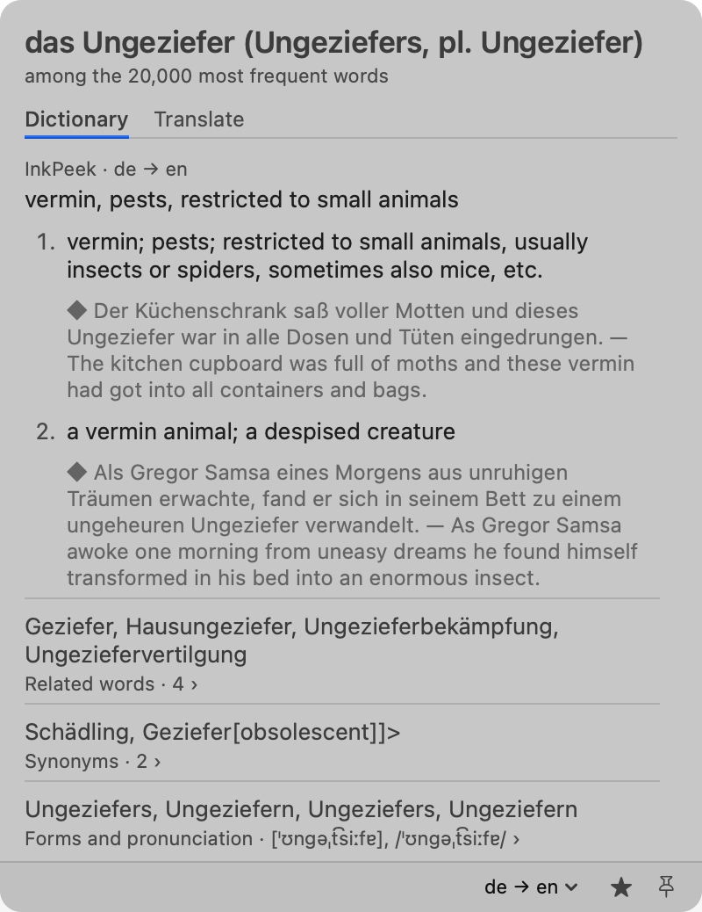
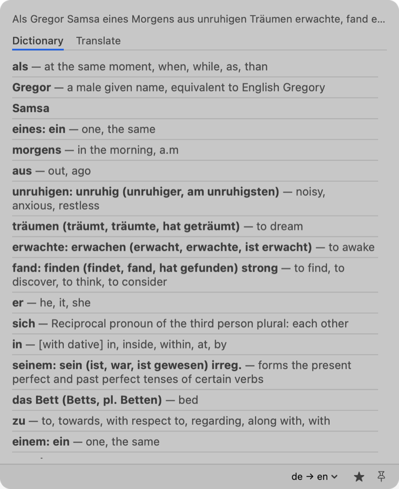
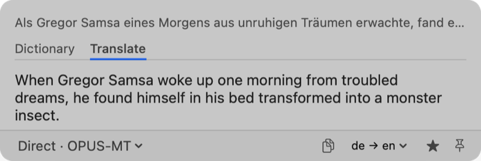
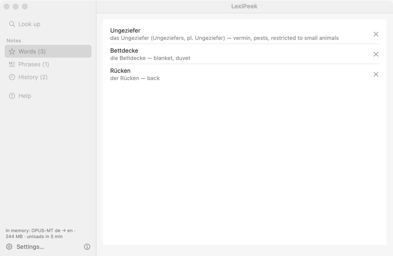
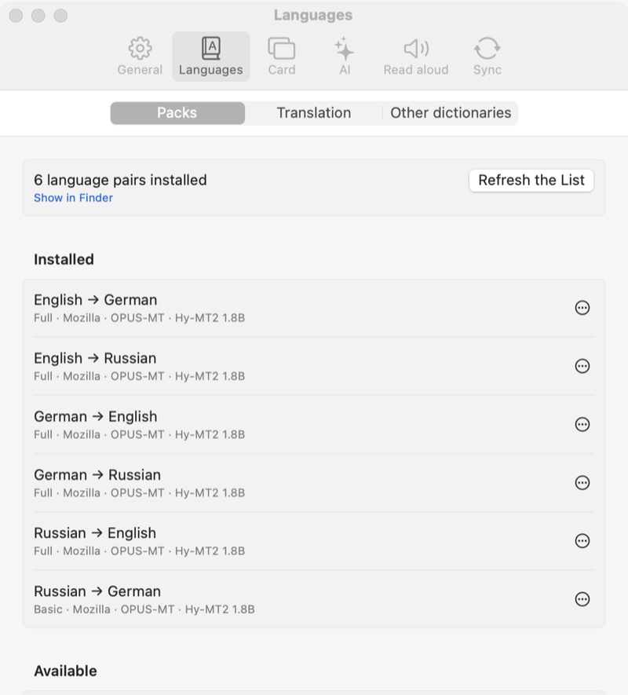
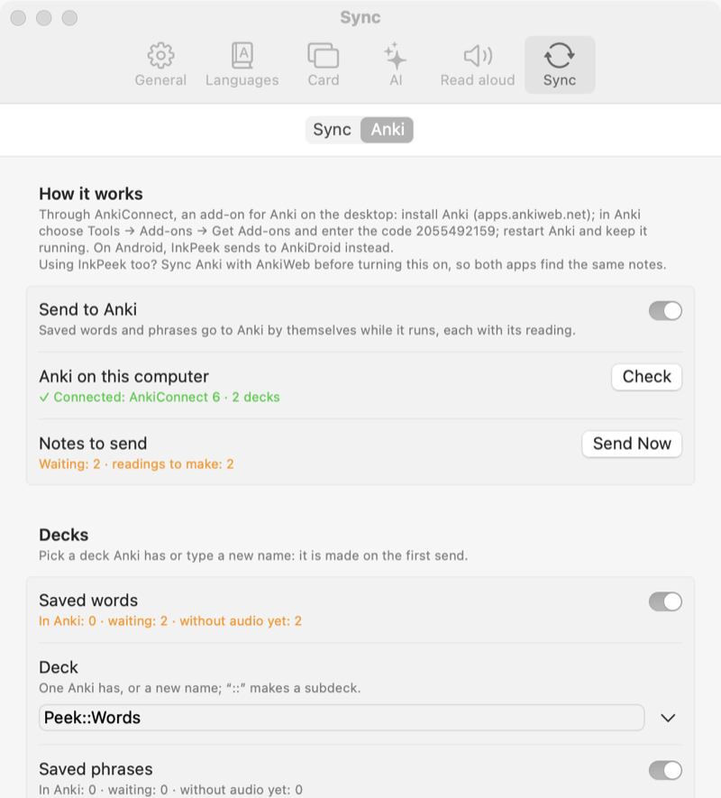

# LexiPeek

**Look up and translate any text on your Mac or PC, offline.**

Select a word or a sentence in any app and press a hotkey. A small card opens next to it: the dictionary entry with
its grammar ("das Haus (Hauses, pl. Häuser)"), the base form of an inflected word, a word-by-word gloss of a phrase,
and a translation made on your computer — no server, no account, no telemetry.

<table>
<tr>
<td width="50%"></td>
<td width="50%"></td>
</tr>
<tr>
<td valign="top"><b>Look up a word.</b> Its grammar and frequency, the senses with examples, related words, synonyms
and forms; inflected forms find their base form.</td>
<td valign="top"><b>Word by word, offline.</b> Each word of a phrase with its base form and meaning; click one to open
its entry.</td>
</tr>
<tr>
<td><br><br>
</td>
<td></td>
</tr>
<tr>
<td valign="top"><b>Translate a sentence or a passage</b> on your computer. <b>Keep what you look up:</b> ☆ saves it to
Notes, the same as InkPeek's.</td>
<td valign="top"><b>Choose your languages.</b> Each pack brings a dictionary, grammar and translation models.</td>
</tr>
</table>

<p align="center"><sub>macOS, Franz Kafka «Die Verwandlung» (public domain), German → English.</sub></p>

## Install

**macOS** 14 or later, Apple Silicon. Download `LexiPeek-macOS.zip` from
[Releases](https://github.com/kafeg/lexipeek/releases), unzip it and move LexiPeek to Applications. It is not notarised
yet, so macOS blocks the first launch: open System Settings → Privacy & Security, find the message naming LexiPeek and
click **Open Anyway**. LexiPeek lives in the menu bar. It reads the selected text through Accessibility (never the
clipboard): allow it in System Settings → Privacy & Security → Accessibility — the first run shows where.

**Windows** 10 (version 1903 or later) or 11, 64-bit. Download `LexiPeek-Windows-Setup.exe` from
[Releases](https://github.com/kafeg/lexipeek/releases) and run it: it installs LexiPeek for you (no administrator
rights; the Start menu; removed in Settings → Apps) and starts it. `LexiPeek-Windows.zip` is the same app to run from
its folder. It is not signed yet: on "Windows protected your PC" click **More info** → **Run anyway**. LexiPeek lives in
the tray (^ on the taskbar).

**Linux** x64 with glibc 2.35 or later (Ubuntu 22.04, Debian 12, Fedora 36 or newer), X11 or Wayland (through
XWayland). Download `LexiPeek-Linux-x64.tar.gz` from [Releases](https://github.com/kafeg/lexipeek/releases), unpack it
anywhere and run `LexiPeek/lexipeek`: it adds itself to the app menu and lives in the tray (GNOME shows it with the
AppIndicator extension; without a tray a second launch opens the window); `lexipeek --uninstall` removes the menu entry.
It reads the primary selection — the text you selected —, never the clipboard. On Wayland, where the desktop gives apps
no global hotkeys, bind `lexipeek --lookup-selection` (and `lexipeek --input`) in its keyboard settings. Read aloud and
the icon at the selection are not on Linux yet.

**First run:** pick the language you read and the one to translate into; the pair downloads once (about 60–240 MB;
the window lists each file and where it comes from) and works offline from then on.

**Hotkeys:** the selection — ⌥D on macOS, Win+Shift+D on Windows, Ctrl+Alt+D on Linux; a card to type in — ⌥A /
Win+Shift+A / Ctrl+Alt+A. On Windows, when another app has taken one, LexiPeek takes Win+Shift+E (Win+Shift+Q), and
says so when that one is taken too. Both can be changed in Settings → General → Hotkeys.

## What it does

- **Packs.** Dictionaries, grammar and translation models come from the language packs of
  [InkPeek](https://github.com/kafeg/inkpeek), the same project's pop-up dictionary for Android e-ink readers: pairs
  among 17 European languages. More pairs: Settings → Languages → Packs. Add your own
  StarDict dictionaries or folders (GoldenDict's, KOReader's), or free ones from a catalog (WikDict, FreeDict,
  Wiktionary).
- **Translation on your computer.** Direct · OPUS-MT (the default), Fast · Mozilla (the lightest), and the Hy-MT2 AI
  model (the most natural, slower; 6 GB of memory; on the GPU when there is one: Metal on a Mac, Vulkan on Windows).
- **Read aloud.** ▶ reads a word or a sentence in a natural voice, female or male, made on the computer; or in your
  own voice from a short recording. Turn it on in Settings → Read aloud: the voice model downloads once (2.4 GB).
- **The language you learn.** Text already in your own language opens in the one you learn: its dictionary line, each
  translated word with its grammar, and the translation (Settings → Languages → Translation).
- **Sync with InkPeek** through any folder you keep in sync: Syncthing, Nextcloud, or the desktop app of your NAS
  or cloud drive. Saved words and phrases, History and AI answers, on any number of devices; each writes only its own
  files. Settings → Sync, with backup and restore.
- **Anki** through its add-on AnkiConnect: saved words and phrases go to their decks by themselves while Anki runs, each
  note with its audio (Settings → Sync → Anki).

  
- **AI is optional.** Off by default. Turn it on in Settings → AI with your own key (Anthropic, OpenAI-compatible,
  OpenRouter), a local server (Ollama, LM Studio) or the `claude` / `codex` command line: it adds an AI translation and
  the Analysis and Context tabs. Only the text you look up and the prompt are sent, and only when you ask.
- **Eight languages** of the interface: English, Russian, German, French, Spanish, Italian, Portuguese, Polish.

## Privacy

No accounts, no telemetry. The network is used only for what you ask: the pack list and downloads (from this
project's and InkPeek's GitHub releases), the voice model (Hugging Face), the update check (on "Check now"), the
dictionary catalog, and AI when it is on. Your notes and history stay on your computer, and in a sync folder if you
choose one. Delete `~/Library/Application Support/LexiPeek` (`%LOCALAPPDATA%\LexiPeek` on Windows,
`~/.local/share/LexiPeek` on Linux) to remove them and the packs.

## Build

C++20 core with all the logic and a thin native shell per OS (SwiftUI on macOS, WinUI 3 on Windows, Qt on Linux); see
[CLAUDE.md](CLAUDE.md) for the layout and [docs/spec.md](docs/spec.md) for the design.

```sh
make deps     # submodules: vcpkg, the engines
make test     # the core and its tests (CMake + Ninja; the first build compiles the dependencies)
make install  # macOS: the app into /Applications
```

On Windows (Visual Studio 2022 or later, or its Build Tools, with C++ and the Windows SDK, CMake, Ninja, Git):
`scripts\build-win.cmd` — the app's folder in `build-win\win\LexiPeek\`.

On Linux (x64, the oldest glibc it should run on; CMake, Ninja, GCC 13 and X11's development headers —
`.github/workflows/linux.yml` lists them): `scripts/build-linux.sh` — the app's folder in `build-linux/LexiPeek/` (Qt
statically linked) and `dist/LexiPeek-Linux-x64.tar.gz`.

## License

MIT (see [LICENSE](LICENSE)). The bundled engines and libraries keep their own licenses — Bergamot / Marian,
fastText, llama.cpp, qwentts.cpp, PCRE2, SQLite, curl, libarchive, on Windows the Windows App SDK and C++/WinRT, on
Linux Qt (LGPL-3.0), and more: see [THIRD_PARTY_NOTICES.txt](THIRD_PARTY_NOTICES.txt). The language packs keep theirs: Wiktionary CC BY-SA,
Mozilla models MPL-2.0, OPUS-MT CC BY 4.0, Hy-MT2 Apache-2.0, fastText's language identification CC BY-SA 3.0; the
voice model Qwen3-TTS Apache-2.0.
