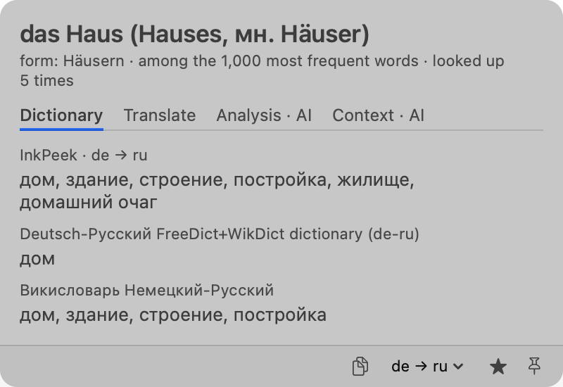
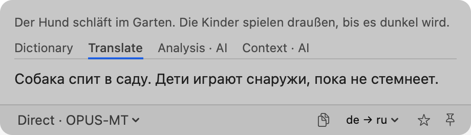
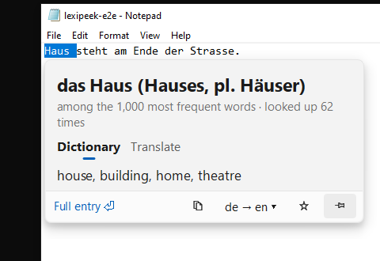

# LexiPeek

**Look up and translate any text on your Mac or PC, offline.**

Select a word or a sentence in any app and press a hotkey. A small card opens next to it: the dictionary entry with
its grammar ("das Haus (Hauses, pl. Häuser)"), the base form of an inflected word, a word-by-word gloss of a phrase,
and a translation made on your computer — no server, no account, no telemetry.

<p>
  
  
</p>


- **Dictionaries first.** Every pack brings a dictionary with grammar (articles, plurals, verb forms) built from
  Wiktionary; add your own StarDict dictionaries or folders (GoldenDict's, KOReader's), or pick free ones from a
  catalog (WikDict, FreeDict, Wiktionary dumps).
- **Translation on your computer.** Three methods: Direct · OPUS-MT (the default), Fast · Mozilla (the lightest), and
  the Hy-MT2 AI model (the most natural, slower; 6 GB of memory).
- **AI is optional.** Off by default. Turn it on in Settings → AI with your own key (Anthropic, OpenAI-compatible,
  OpenRouter), a local server (Ollama, LM Studio) or the `claude` / `codex` command line: it adds Analysis and Context
  tabs and an AI translation. Only the text you look up and the prompt are sent, and only when you ask.
- **Notes.** ☆ keeps a word or a phrase; History, export for Anki (TSV), backup and restore.
- **Eight languages** of the interface: English, Russian, German, French, Spanish, Italian, Portuguese, Polish.

Dictionaries, grammar and models come from the language packs of [InkPeek](https://github.com/kafeg/inkpeek), the
same project's pop-up dictionary for Android e-ink readers.

## Install

**macOS** 14 or later, Apple Silicon. Download `LexiPeek-macOS.zip` from
[Releases](https://github.com/kafeg/lexipeek/releases), move LexiPeek to Applications and open it (until it is notarised, macOS blocks the first launch: System Settings →
Privacy & Security → Open Anyway). LexiPeek lives in
the menu bar. It reads the selected text through Accessibility (never the clipboard): allow it in System Settings →
Privacy & Security → Accessibility — the first run shows where.

**Windows** 10 or 11, 64-bit. Download `LexiPeek.exe` from [Releases](https://github.com/kafeg/lexipeek/releases) and
run it: it offers to install itself for you (no administrator rights; the Start menu; removed in Settings → Apps) or
to just run. Until the exe is signed, Windows may warn that it is from an unknown publisher: "More info" → "Run
anyway". LexiPeek lives in the tray (^ on the taskbar).

**First run:** pick the language you read and the one to translate into; the pair downloads once (about 60–240 MB)
and works offline from then on. More pairs: Settings → Languages → Packs.

**Hotkeys:** the selection — ⌥D on macOS, Ctrl+Alt+D on Windows; a card to type in — ⌥A / Ctrl+Alt+A. Both can be
changed in Settings → General → Hotkeys.

## Privacy

No accounts, no telemetry. The network is used only for what you ask: the pack list and downloads (from this
project's GitHub releases), the update check (on "Check now"), the dictionary catalog, and AI when it is on. Your
notes and history stay on your computer (`~/Library/Application Support/LexiPeek`, `%LOCALAPPDATA%\LexiPeek`):
delete that folder to remove them and the packs.

## Build

C++20 core with all the logic and a thin native shell per OS (SwiftUI on macOS, Qt Widgets on Windows); see
[CLAUDE.md](CLAUDE.md) for the layout and [docs/spec.md](docs/spec.md) for the design.

```sh
make deps     # submodules: vcpkg, the engines
make test     # the core and its tests (CMake + Ninja; the first build compiles the dependencies)
make install  # macOS: the app into /Applications
```

On Windows: `cmake -S . -B build -G Ninja -DCMAKE_BUILD_TYPE=Release` in a Visual Studio x64 prompt, then
`cmake --build build` — `build\qt\LexiPeek.exe` (Qt statically linked; build against your own Qt to relink).

## License

MIT (see [LICENSE](LICENSE)). The bundled engines and libraries keep their own licenses — Bergamot / Marian,
fastText, llama.cpp, PCRE2, SQLite, curl, libarchive, Qt (LGPLv3, Windows) and more: see
[THIRD_PARTY_NOTICES.txt](THIRD_PARTY_NOTICES.txt). The language packs keep theirs: Wiktionary CC BY-SA, Mozilla
models MPL-2.0, OPUS-MT CC BY 4.0, Hy-MT2 Apache-2.0, fastText's language identification CC BY-SA 3.0.
